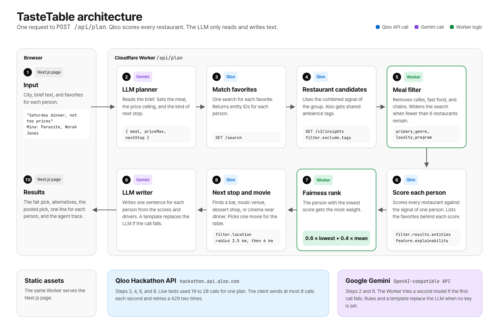

# TasteTable

TasteTable plans a group dinner where nobody gets stuck at a restaurant they hate. Each person lists a few movies, artists, shows, or books they love. The agent turns those favorites into Qloo entities. It gets restaurants from the combined taste of the group. Then it scores every restaurant against each person. It picks the restaurant where the person with the lowest score is still happy. Next, it finds a next stop near dinner and a film for the whole table. It explains each pick to each person with the Qloo signals behind it.

Live demo: https://tastetable.graphite-site.workers.dev

The demo calls the live Qloo API (`hackathon.api.qloo.com`). The badge in the header says "Live Qloo API", and the agent trace under each result lists every request with its status. Without a Qloo key the server refuses to plan.

## Why Qloo and not just an LLM

An LLM asked "where should Mina, Leo, and Ava eat?" produces a confident list with no way to tell whether Leo actually fits. TasteTable needs a number for each person and each restaurant. That number must come from behavior data. A guess from the model about the food of a Daft Punk fan is not enough. Qloo's Insights API gives a cross-domain affinity score (movies and music in, restaurants out) and can re-score a fixed candidate list against one person's signals. That is what makes the fairness step possible.

A pooled signal averages the taste of the whole group. That average can favor the majority. TasteTable gives the most weight to the person with the lowest score. In a live run on 2026-10-29, the "Film-club friends" preset picks Joe's Pizza. At Joe's Pizza, the lowest score is Mina at 78%. The "Mixed crowd birthday" preset picks Battery Gardens. At Battery Gardens, the lowest score is Yuki at 84%. In both presets, the pooled ranking and the fair ranking put the same restaurant first. Live scores for well-known favorites are close together. For the top three restaurants in both presets, every personal score is between 77.9% and 89.4%. For these presets, the fairness step works as a tie-breaker. When the pooled pick and the fair pick are different, the results page shows both.

## How it works



The HTML source of the figure is [docs/architecture.html](docs/architecture.html).

```
brief text ──► LLM planner ──► price ceiling, kind of next stop
favorites  ──► GET /search (one per favorite) ──► entity IDs per person

GET /v2/insights  urn:tag            shared ambience tags for the whole group (filter.tag.types=urn:tag:ambience:qloo)
GET /v2/insights  urn:entity:place   candidates: filter.tags=urn:tag:category:place:restaurant,
                                      filter.exclude.tags=<cafe, fast food tags>,
                                      filter.location.query=<city>, combined signals
meal filter       drop cafes, fast food, and chains (primary_genre, loyalty_program, website);
                  fewer than 6 left: take=50, then no price ceiling, then bars that serve food
GET /v2/insights  urn:entity:place   per person: filter.results.entities=<candidates>,
                                      signal.interests.entities=<their IDs>, feature.explainability=true
rank by fairness = 0.6 × lowest affinity + 0.4 × mean affinity
GET /v2/insights  urn:entity:place   next stop: filter.location=POINT(<dinner lon> <dinner lat>), radius 2.5 km, then 6 km
GET /v2/insights  urn:entity:movie   film pool, then per-person scoring
LLM writer        one sentence per person per pick, from the scores and drivers only
```

A full run makes 19 to 28 Qloo calls in our live tests, which stays under the Cloudflare Workers free-plan limit of 50 subrequests. The hackathon key allows 10 requests per second. The client starts at most 8 requests per second. It retries a 429 up to two times. The agent trace at the bottom of the results lists every call with its parameters and status.

The meal filter removes cafes, fast food, and chains from the dinner candidates. A chain needs two signals from the Qloo data, for example a loyalty program and a branch page on the website. Bars without a dinner tag go to the end of the list.

The LLM never ranks anything. It reads the brief to set a price ceiling and the next-stop kind. It writes the explanations from a JSON evidence object. Without an LLM key, a rule-based parser and a sentence template take over. If the first model fails, the Worker tries a second model. If both models fail, the response gives the reason in `story.fallbackReason`.

## Code map

| Path | What it does |
| --- | --- |
| `lib/qloo/client.ts` | The only place that talks to Qloo. Calls `https://hackathon.api.qloo.com` with `X-Api-Key`, throttles to 8 requests per second, retries 429. Uses the mock only when `QLOO_MOCK=1`. |
| `lib/qloo/mock.ts` | Deterministic mock of `/search`, `/v2/tags`, `/v2/insights` for tests, shaped like the live responses. |
| `lib/qloo/fixtures.ts` | Hand-written test catalog: 31 input entities and 27 fictional New York places. Three of the places are decoys for the meal filter. |
| `lib/agent.ts` | The agent: resolve, plan, fetch candidates, filter, score per person, rank, explain. |
| `lib/meal.ts` | The meal filter: Qloo exclude tags, chain signals, and the order of fallback candidates. |
| `lib/llm.ts` | OpenAI-compatible chat call. Gemini `gemini-3.1-flash-lite` by default. It tries `gemini-3.5-flash-lite` when the first call fails. |
| `worker/index.ts` | Cloudflare Worker: `/api/plan`, `/api/health`, static assets. |
| `app/` | Next.js static export for the UI. |
| `scripts/check-qloo.ts` | Calls the live API, prints the response shapes the app depends on, and fails if one changes. |

## Run it

```bash
npm install
npm test                 # agent tests against the mock (sets QLOO_MOCK=1)
npm run build:static     # Next.js static export to out/
npx wrangler dev --port 3103
```

With a Qloo key:

```bash
QLOO_API_KEY="..." node scripts/check-qloo.ts --agent
```

Deploy to Cloudflare Workers:

```bash
npm run deploy
./scripts/set-secrets.sh   # reads both keys from the macOS keychain
./scripts/smoke.sh         # expects "qloo":"live" and non-2xx 0
```

| Variable | Required | Default |
| --- | --- | --- |
| `QLOO_API_KEY` | Yes. Without it `/api/plan` returns an error. | none |
| `QLOO_MOCK` | No. `1` uses the test fixtures instead of the API. | unset |
| `QLOO_BASE_URL` | No | `https://hackathon.api.qloo.com` |
| `LLM_API_KEY` | No. Without it the app uses rules and templates. | none |
| `LLM_BASE_URL` | No | `https://generativelanguage.googleapis.com/v1beta/openai/` |
| `LLM_MODEL` | No | `gemini-3.1-flash-lite` |
| `LLM_FALLBACK_MODELS` | No. Comma-separated. The Worker tries them when a call fails. | `gemini-3.5-flash-lite` |

## Live API notes

Checked against `hackathon.api.qloo.com` on 2026-10-29 with `scripts/check-qloo.ts`. This repository does not keep API responses, per the Qloo hackathon FAQ. We wrote the test fixtures by hand.

- `/search` returns `results` as an array. Each entity has `types[]` but no `subtype`. Without a `types` filter, short titles such as "Chef" or "The Bear" match a place or an album. The agent limits search to movies, artists, TV shows, books, video games, and podcasts.
- Per-result affinity is in `query.affinity`. There is no top-level `affinity`.
- `query.explainability` is `{ "signal.interests.entities": [{ entity_id, score }] }`, with scores that add up to 1.
- `filter.location` rejects an entity ID with a 400 error, `No shapes were found`. A WKT point, `POINT(lon lat)`, works. Each result then has `query.distance` in meters.
- `urn:tag:category:place:music_venue` returns nothing. The agent uses `urn:tag:category:place:live_music_venue`.
- Place results carry `properties.address`, `price_level` (1 to 4, sometimes missing), `business_rating`, `short_description`, and `location { lat, lon }`. Results without a price level are often malls or neighborhoods. The dinner pool drops them when at least six priced restaurants remain.
- Errors come back as `{ "errors": [{ "message", "path" }] }`.
- Rate limit headers: `x-second-ratelimit-limit: 10`, plus a monthly limit.

## License

MIT
